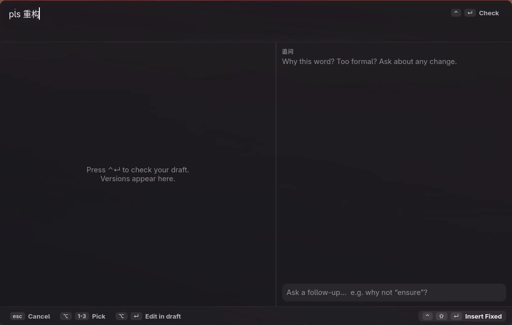

# saywell

Say it well: write English to AI coding agents with help, and learn from your own mistakes.



- `saywell`: reads a draft on stdin and prints it with the grammar fixed and any Chinese translated. It works as an editor filter, such as nvim `<leader>cg`.
- `saywell-popup`: a Raycast-style panel on a hotkey. Type a draft, check it, pick a version and paste it where your cursor was.
- `saywell --learn`: works offline, away from your writing. It reads everything you wrote (drafts and follow-up questions) and extracts 知识点 into a personal knowledge base. Repeated mistakes are counted.

The CLI needs only Python 3.11+ and runs anywhere. The popup is built for Hyprland on Wayland (Linux). On Windows a tray app opens a Qt port of the popup on a global hotkey; see [Windows](#windows).

## Setup

```sh
git clone https://github.com/InertialG/saywell.git && cd saywell
ln -s "$PWD/saywell" ~/.local/bin/saywell
ln -s "$PWD/saywell-popup" ~/.local/bin/saywell-popup   # optional, Hyprland only
mkdir -p ~/.config/saywell && cp config.example.toml ~/.config/saywell/config.toml
```

The default provider is `claude`: it runs `claude -p --model haiku` on your Claude subscription. The config also lists a local llama.cpp server and several free API providers.

Privacy: your drafts go to the provider you pick. Everything else (the log, the 知识点 and the usage records) stays on your machine.

The popup needs GTK4 and libadwaita (PyGObject), `wl-copy`, `wtype` and Hyprland. Add this to `~/.config/hypr/bindings.lua`:

```lua
o.bind("SUPER + ALT + E", "Saywell", os.getenv("HOME") .. "/.local/bin/saywell-popup")
```

Add this to `~/.config/hypr/hyprland.lua`:

```lua
o.window("^uno\\.guan810\\.Saywell$", {
  float = true, center = true, size = { 1040, 660 }, pin = true,
  dim_around = true, rounding = 12, border_size = 0, tag = "-default-opacity",
})
```

To learn every hour, use the systemd user timer:

```sh
ln -s "$PWD"/contrib/saywell-learn.{service,timer} ~/.config/systemd/user/
systemctl --user daemon-reload && systemctl --user enable --now saywell-learn.timer
```

## CLI

```sh
echo "why the test is fail" | saywell           # -> Why is the test failing?
saywell --json < draft.txt                      # fixed, improved, 含义 back-translations, meaning flags
saywell --json --stream < draft.txt             # progress lines while the model writes (for the popup)
saywell --json < d.txt | saywell --ask "why not ensure?"
saywell --learn                                 # extract 知识点 from messages logged since the last run
saywell --notes 20                              # your 20 most frequent 知识点
saywell --usage 30                              # tokens and API-equivalent cost, last 30 days
saywell --bench | --list | --models -p NAME
```

Data lives in `~/.local/share/saywell/`:
- `log.jsonl`: every fix, check and follow-up question.
- `notes.jsonl`: the 知识点, one per line, merged by `from → to`, with a count and example sources.
- `learn-state.json`: how far `--learn` has read.
- `usage.jsonl`: tokens, time and cost of every model call. `saywell --usage [DAYS]` sums them.

## The popup

- **Top bar:** your draft.
- **Left:** the fixed, improved and original versions, with changed words highlighted. Hover over a version to list its changes. Each version shows a Chinese back-translation (含义) so you can check the meaning. Double-click a version, or press Alt+Enter, to copy it into the draft and keep writing.
- **Right:** step-by-step progress while checking. Then comes the meaning check: real meaning changes are warned about, tone-only changes are marked 语气, and pure grammar fixes are hidden. Below it is a chat for follow-up questions.

| Key | Action |
|---|---|
| Ctrl+Enter | check the draft |
| Alt+1 / 2 / 3, or click a version | pick fixed / improved / my draft |
| Alt+Enter, or double-click a version | copy that version into the draft to keep writing |
| Ctrl+Shift+Enter, or click Insert | paste the picked version into the previous window |
| Enter in the follow-up box | ask a question about the English |
| Esc | close without pasting |

The text goes back through the clipboard and a paste shortcut, not typed keystrokes. The paste shortcut is Ctrl+Shift+V in terminals and Ctrl+V elsewhere. Typed keystrokes would go through fcitx5, and a newline would send a chat message. The pasted text stays on the clipboard afterwards.

## Windows

On Windows saywell is a tray app. A global hotkey opens the popup over the window you are typing in, and the version you insert is pasted back into that window. The CLI and `--learn` work as on Linux.

### Install

You need [uv](https://docs.astral.sh/uv/) and Claude Code (or an API provider, see below). uv brings a Python 3.11+ and PySide6 (`pyside6-essentials`, installed on Windows only).

```powershell
uv tool install git+https://github.com/InertialG/saywell.git
# or, from a clone:  git clone https://github.com/InertialG/saywell.git; cd saywell; uv tool install .
saywell-tray                       # start the tray now
saywell-autostart enable           # and at every logon (or tick "Start at logon" in the tray menu)
```

This installs three commands into uv's tool bin dir (`uv tool dir --bin`; run `uv tool update-shell` once if it is not in PATH):

- `saywell`: the CLI, the same as on Linux (see [CLI](#cli)).
- `saywell-tray`: the tray, with no console window. Started again while it runs, it opens the popup of the running tray instead.
- `saywell-autostart enable|disable|status`: start `saywell-tray` at logon. It writes the `Saywell` value under `HKCU\Software\Microsoft\Windows\CurrentVersion\Run`, pointing at the installed `saywell-tray.exe`.

To upgrade, quit the tray (Windows locks a running exe), then run `uv tool upgrade saywell`. From a clone, run `uv tool install --reinstall .`.

### Claude and providers

The default provider runs `claude -p --model haiku` on your Claude subscription. Install Claude Code and log in once with `claude`. On Windows the `claude` in PATH is an npm `.cmd`/`.ps1` shim that Python cannot start, so saywell looks for the real `claude.exe`: first in PATH, then behind the npm or Volta shim, then in `~\.local\bin` (the native installer) and `%APPDATA%\npm`. If it is somewhere else, set `$env:SAYWELL_CLAUDE` or `command` in the provider to the full path of `claude.exe`. The API providers in the config work the same as on Linux.

### Config and data

The paths are the Linux ones under your user profile, and `XDG_CONFIG_HOME` / `XDG_DATA_HOME` move them as on Linux:

- Config: `%USERPROFILE%\.config\saywell\config.toml`. The first run of `saywell` or `saywell-tray` copies `config.example.toml` there if it is missing. It never overwrites an existing config.
- Data: `%USERPROFILE%\.local\share\saywell\` (`log.jsonl`, `notes.jsonl`, `learn-state.json`, `usage.jsonl`, as on Linux), plus `tray.log`, the tray's log.

The tray reads a `[windows]` table in the same config. The backend ignores it.

```toml
[windows]
hotkey = "Win+Alt+E"              # opens the popup
paste = "Ctrl+V"                  # paste keys for ordinary windows
terminal_paste = "Ctrl+Shift+V"   # paste keys for terminals
extra_terminals = ["myterm.exe"]  # more window classes / exe names that are terminals
learn_interval_minutes = 60       # run `saywell --learn` this often; 0 turns it off

[windows.paste_keys]              # per window class or exe name; wins over the two above
"mintty.exe" = "Shift+Insert"
```

Restart the tray after you change the config.

### Hotkey, tray and pasting

- **Win+Alt+E** opens the popup centred on the screen with the mouse. The keys inside the popup are the ones in [the popup](#the-popup) table. Ctrl+Shift+Enter pastes the picked version into the window you came from.
- If another program already uses the hotkey, the tray says so at start. Pick another `hotkey` and restart. Until then, click the tray icon to open the popup. Text inserted from a popup opened this way only goes to the clipboard.
- The tray menu has Open Saywell, Learn now, Start at logon and Quit.
- Paste keys: Windows Terminal gets Ctrl+Shift+V. conhost (the classic console) and mintty (Git Bash, MSYS2) get **Shift+Insert**: conhost types `^V` for Ctrl+Shift+V, and mintty pastes with it only when its Ctrl+Shift shortcuts option is on. Other terminals (ConEmu, WezTerm, Alacritty, ...) get Ctrl+Shift+V, and all other windows get Ctrl+V. Change any of these with `paste`, `terminal_paste` or `[windows.paste_keys]`.
- Windows will not let the tray paste into a program that runs as administrator (UIPI). The text then stays on the clipboard; paste it yourself.

### Learn

The tray runs `saywell --learn` every hour (`learn_interval_minutes`), and the tray menu has Learn now. A scheduled run that fails only goes to `tray.log`. Without the tray, run `saywell --learn` yourself or from Task Scheduler. `saywell --notes 20` lists your most frequent 知识点.

### Uninstall

```powershell
saywell-autostart disable          # first, or the Run key points at a missing exe
# quit the tray from its menu
uv tool uninstall saywell
```

This leaves your config and data. Delete `%USERPROFILE%\.config\saywell` and `%USERPROFILE%\.local\share\saywell` to remove them too.

### From a checkout

Without installing, run the same scripts with uv:

```powershell
python saywell --list
uv run --no-project --with pyside6-essentials pythonw windows/saywell_tray.py
uv run --no-project --with pyside6-essentials python windows/saywell_tray.py autostart enable
```

### End-to-end test (端到端测试)

One command, from the repo root, in cmd, PowerShell or by double-click:

```powershell
.\scripts\windows\e2e.cmd                        # Windows PowerShell 5.1
pwsh -NoProfile -ExecutionPolicy Bypass -File scripts\windows\e2e.ps1   # the same under PowerShell 7
```

It checks the environment (uv, Python 3.11+, PowerShell, `claude.exe` for the claude provider, a running tray), runs the unit tests, installs the checkout with `uv tool install`, runs `saywell`, `saywell --json`, `--learn` and `--usage` on a real provider, then starts the installed `saywell-tray.exe` and prints a checklist for testing the hotkey, the paste and the tray menu by hand. Press Enter when done; it stops only the tray it started, uninstalls, and prints PASS / FAIL / SKIP for each step. The exit code is 0 when nothing failed, 1 when a step failed, and 2 when the config needs your API key first.

**API key.** The first run copies `scripts\windows\e2e.config.example.toml` to `.e2e\config\saywell\config.toml`, opens it in Notepad and stops. Paste your key into `api_key` of `[providers.api]` (and change `base_url` and `model` if you do not use DeepSeek), save, and run again. The script stops the same way while the default provider's key is the placeholder or empty. It never prints the key or writes it to the logs. Without a key, use your Claude subscription: `-Provider claude`.

| Parameter | |
|---|---|
| `-Provider NAME` | use this provider for this run (e.g. `claude`) and skip the key check of the default |
| `-SkipTests` | skip the unit tests |
| `-SkipTray` | skip the tray step |
| `-NonInteractive` | never wait for input or open Notepad; implies `-SkipTray` (for CI and agents) |
| `-Keep` | keep the sandbox install afterwards, to test the tray again by hand |
| `-Clean` | delete the whole sandbox, including the config with your key, and exit |

**Sandbox.** Everything lives in `.e2e\` in the repo (ignored by git): `config\` (`XDG_CONFIG_HOME`), `data\` (`XDG_DATA_HOME`, emptied at each run), `cache\`, `uv\tools` and `uv\bin` (`UV_TOOL_DIR`, `UV_TOOL_BIN_DIR`), and `logs\`, one full log per run. The variables are set only inside the script and restored at its end. The sandbox tray uses its own single-instance name, but there is only one Win+Alt+E: quit your real tray before you test the hotkey. The last step checks that `%USERPROFILE%\.config\saywell`, `uv tool list` and the `HKCU\...\Run` values are the same as before the run.

### Troubleshooting

- **Chinese shows as `?` or mojibake.** saywell reads and writes UTF-8 whatever the console code page is. Windows PowerShell 5.1 sends pipes to programs as ASCII, though, so `"中文" | saywell` arrives as `?`. Run `$OutputEncoding = [Console]::OutputEncoding = [Text.UTF8Encoding]::new()` first, or use PowerShell 7.
- **`claude.exe not found`.** Check that `claude --version` works. Then set `$env:SAYWELL_CLAUDE` to the full path of `claude.exe` (for npm: `%APPDATA%\npm\node_modules\@anthropic-ai\claude-code\bin\claude.exe`). When you test from inside a Claude Code session, remove `CLAUDECODE` from the environment first.
- **The hotkey does nothing.** Look in `tray.log` for `hotkey ... not registered`. Pick a free `hotkey` and restart the tray.
- **Nothing is pasted.** If the target runs as administrator, see the UIPI note above. If the terminal gets the wrong keys, add it to `[windows.paste_keys]`. `tray.log` records which keys went to which window.
- **The tray does not start at logon.** Run `saywell-autostart status` and check that the exe it shows still exists. If you reinstalled uv tools elsewhere, run `saywell-autostart enable` again.

## License

MIT
